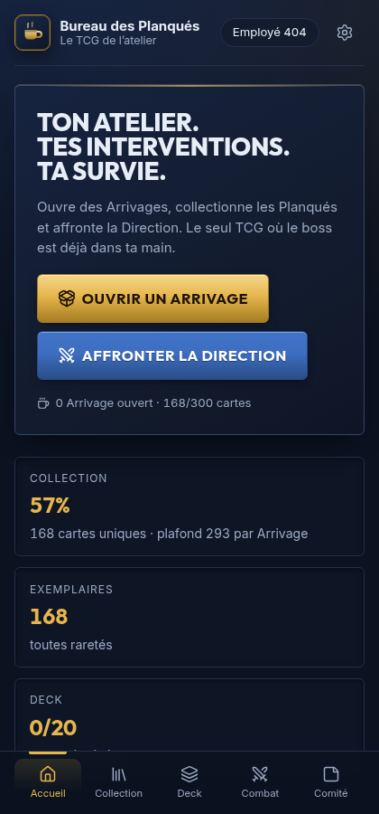
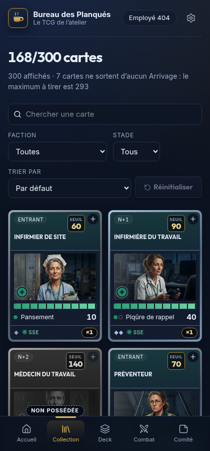
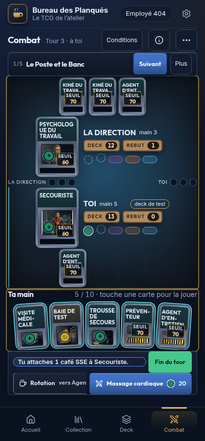

<p align="center">
  <picture>
    <source media="(prefers-color-scheme: dark)" srcset="design/logo/cafe-sombre.svg">
    
  </picture>
</p>

<h1 align="center">Bureau des Planqués</h1>

<p align="center">
  <strong>Le TCG de l'atelier.</strong> Un jeu de cartes à collectionner, satire du monde de l'entreprise,<br>
  qui suit les règles de TCG Pocket — en français, sur le téléphone, sans argent réel.
</p>

<p align="center">
  <a href="https://github.com/bureau-des-planques/planquex/actions/workflows/ci.yml"></a>
  <a href="https://github.com/bureau-des-planques/planquex/releases"></a>
  <a href="LICENSE"></a>
  <a href=".nvmrc"></a>
  <a href="https://planquex.4k7.org"></a>
  <a href="https://planquex.4k7.org/installation"></a>
</p>

<p align="center">
  <a href="https://planquex.4k7.org"><strong>Jouer</strong></a> ·
  <a href="CONTRIBUTING.md">Contribuer</a> ·
  <a href="#où-lire-quoi">Documentation</a> ·
  <a href="https://planquex.4k7.org/feuille-de-route">Feuille de route</a> ·
  <a href="https://github.com/bureau-des-planques/planquex/issues">Tickets</a>
</p>

> Ici, on ne se bat pas : on met la **Pression**. Le Planqué adverse encaisse du **Stress** jusqu'à
> son **Seuil**, puis il **craque**. Trois **Interventions** et la partie est pliée — et la Pression,
> elle, ne consomme jamais le café.

---

## Jouer à l'alpha

**Le jeu tourne en production sur [planquex.4k7.org](https://planquex.4k7.org).** C'est une alpha :
le solo se joue de bout en bout, le reste arrive, et ce qu'on cherche est simple — est-ce que ça
donne envie de refaire une partie ?

| | Ce qu'on y trouve |
|---|---|
| ✅ | **Le solo** contre la Direction : Poste, Banc, Machine à café, Pressions, Conditions, trois Interventions |
| ✅ | **Les Arrivages** (3 communes, 1 peu commune, 1 rare au minimum), la **Collection** filtrable, le **Deck** de 20 cartes avec ses types de café |
| ✅ | **Le comité** : le mur des retours, où l'on colle un post-it IP (idée) ou OUF (défaut) |
| ✅ | **Le set illustré** : chaque carte de base a son image, les variantes héritent de la leur |
| ⛔ | **Le classé**, **l'Économat du CSE**, **les notes de service** et la **Cotisation** — pas encore |
| ⛔ | **L'argent réel** : aucun paiement et aucune monnaie payante dans l'alpha |

Le jeu s'installe comme une application (PWA) : la marche à suivre par appareil est sur
[`/installation`](https://planquex.4k7.org/installation), et ce que chaque version apporte sur
[`/feuille-de-route`](https://planquex.4k7.org/feuille-de-route).

⚠️ **La Collection et le Deck vivent sur l'appareil.** Vider les données du navigateur les efface :
**Réglages → « Créer ma sauvegarde »** avant. Le message complet aux testeurs est
[`docs/ALPHA-TESTEURS.md`](docs/ALPHA-TESTEURS.md).

<p align="center">
  
  
  
</p>

## Comprendre le jeu en deux minutes

**Les règles sont celles de TCG Pocket ; seuls les noms changent.** Aucune valeur mathématique ne
bouge — le périmètre est borné par les décisions D-018 et D-020.

| Dans le jeu de référence | Ici | Ce que ça veut dire |
|---|---|---|
| carte de personnage | **Planqué** | un personnage d'une seule faction, qui monte en grade |
| Basic → Stage 1 → Stage 2 | **Entrant → N+1 → N+2** | l'échelle d'évolution |
| ex | **COMEX** | un statut : il vaut 2 Interventions au lieu d'une |
| HP / dégâts | **Seuil** / **Stress** | le Stress monte ; à `Stress ≥ Seuil`, le Planqué craque |
| Energy | **Café** | produit par la Machine à café, un par tour ; la Pression ne le consomme pas |
| Attack | **Pression** | une par tour, et elle termine le tour |
| Prize | **Intervention** | trois pour gagner |
| Bench / Active | **Banc** / **Poste** | trois places sur le Banc, une au Poste |

Dix factions — RH, SSE, QVT, Management, Atelier, Syndicat, Direction, Amélioration continue,
Support, Intérim — rangées dans trois **viviers** : l'Atelier, l'Étage et les Bureaux. Le
vocabulaire complet est dans [`docs/JEU.md` §3](AGENTS.md#3-vocabulaire), la table des règles dans
[`docs/JEU.md` §4](AGENTS.md#4-règles-du-jeu), et chaque règle y cite sa source.

## Lancer le projet

**Node 24, npm et git.** La CI épingle Node 24 ; `.nvmrc` le dit à `nvm`. Chrome n'est utile que
pour les captures et le contrôle visuel des écrans.

```bash
git clone https://github.com/bureau-des-planques/planquex.git
cd planquex
nvm use                              # lit .nvmrc → Node 24
npm run installer -- --principal     # npm ci, dans un clone frais
npm run dev                          # http://localhost:5178
```

Le jeu démarre **sans configuration** : sans `.env`, le mur du comité lit `docs/comite.json` et
personne n'est contacté. Pour brancher Supabase, copier `.env.example` en `.env`.

🔒 **La seule clé du client est la clé publique.** Une clé de service (`sb_secret_…`) contourne les
règles d'accès : le module la refuse, et elle ne se commite jamais.

⚠️ **Écran blanc en dev, et le terminal ne dit rien ?** C'est le service worker d'un build resté sur
`localhost:5178`. DevTools → Application → Service Workers → *Unregister*, puis *Clear site data*
— le détail est dans [`docs/COMMANDES.md` §7.1](docs/COMMANDES.md#71-piège-connu--le-service-worker-casse-le-dev-sur-la-même-origine).

## Les scripts du quotidien

Quatre commandes pour démarrer. La liste complète, avec ce que fait chaque script, est dans
**[`docs/COMMANDES.md`](docs/COMMANDES.md)** : c'est la seule table des commandes du dépôt.

| Commande | Ce qu'elle fait |
|---|---|
| `npm run dev` | le serveur Vite, sur le port 5178 |
| `npm test` | toute la suite Vitest |
| `npm run build` | le build de production : `dist/index.html` **et** `dist/sw.js` |
| `npm run capturer` | photographie les écrans à la taille d'un téléphone (après un `npm run build`) |

Les autres — `npm run check`, `npm run status` (les décomptes de cartes et de tests, qui ne se
recopient dans aucun document), la release, le poste de pilotage — sont dans
[`docs/COMMANDES.md`](docs/COMMANDES.md).

## Contribuer

**Une issue d'abord, une branche ensuite, une pull request pour finir.**

1. Ouvrir ou choisir une **issue** : un défaut ou une idée, avec le domaine en tête du titre.
2. Travailler sur une **branche dédiée**, créée depuis `main`, dans son propre worktree.
3. Faire passer `check`, `format:check`, `test`, `garde-fous` et `build`.
4. Proposer une **pull request** vers `main` : la CI lance trois jobs en parallèle, tous doivent être verts.
5. La fusion se fait **par merge commit uniquement** — ni squash ni rebase — et la branche est supprimée.

👉 Le guide complet — cloner, poser une issue, la résoudre, proposer la PR, et **quel skill
utiliser à chaque étape** — est dans [`CONTRIBUTING.md`](CONTRIBUTING.md).

## Développer avec un agent

**`AGENTS.md` est la seule source de règles, quel que soit l'outil.** Chaque outil la lit à sa façon :

| Outil | Ce qu'il lit | Pour démarrer |
|---|---|---|
| **OpenCode** | `AGENTS.md`, `opencode.jsonc`, les skills de `.agents/skills/` et `.opencode/skills/` | `opencode` à la racine du dépôt |
| **Claude Code** | `CLAUDE.md`, qui importe `AGENTS.md` | `claude` à la racine, puis le plugin des skills |
| **Codex** | `AGENTS.md`, nativement | `codex` à la racine, réseau ouvert pour `npm ci` |
| **VS Code** | `.vscode/` : Prettier à l'enregistrement, Vitest, Tailwind | accepter les extensions recommandées |

L'installation des skills (Matt Pocock, Impeccable), les réponses au setup et les serveurs MCP
sont détaillés dans [`CONTRIBUTING.md`](CONTRIBUTING.md#outiller-son-agent).

## Déploiement

**Un push sur `main` publie.** Le projet Vercel `planquex` est lié au dépôt ; il n'y a ni étape
manuelle ni branche de préproduction.

| Événement | Ce qui se passe |
|---|---|
| Pull request vers `main` | la CI (contrôles, tests du noyau, tests des écrans) et une préversion Vercel — protégée par défaut par l'authentification Vercel, donc réservée à l'équipe |
| Fusion sur `main` | la production, servie sur [`planquex.4k7.org`](https://planquex.4k7.org) |
| `planquex.vercel.app` | redirige en `308` vers le domaine : une seule origine, donc un seul stockage local par testeur |
| Visite directe d'une route (`/collection`, `/deck`…) | réécrite vers `index.html` par [`vercel.json`](vercel.json) |
| Tag `v*` | `fichiers-generes.yml` vérifie que les fichiers générés de la feuille de route (`versions.ts`, `plan-dev.ts`) sont à jour |

`main` est protégée : un push direct est refusé, propriétaire compris, et les trois jobs de la CI
sont exigés. La version suit [`docs/VERSIONS.md`](docs/VERSIONS.md) — `0.1.x` pour l'alpha, `0.2.x`
pour la beta, `1.0.0` pour la sortie — et la version servie se lit dans **Réglages**.

## Où lire quoi

**Les documents ont un ordre d'autorité ; en cas de conflit, le premier l'emporte.**

| Document | Ce qu'il tranche |
|---|---|
| [`docs/DECISIONS.md`](docs/DECISIONS.md), par son [index](docs/DECISIONS-INDEX.md) | toutes les décisions datées : l'autorité finale |
| [`AGENTS.md`](AGENTS.md) | les règles du jeu, le vocabulaire, les conventions, la définition de « fini » |
| [`docs/CARD-SPEC.md`](docs/CARD-SPEC.md) · [`docs/FACTIONS.md`](docs/FACTIONS.md) | la structure du set, les courbes de stats, les factions |
| [`DESIGN.md`](DESIGN.md) | la palette, le gabarit de carte, la mascotte, les planches de style |
| [`docs/ARCHITECTURE.md`](docs/ARCHITECTURE.md) | le moteur, le store, la CI, la PWA, Supabase |
| [`docs/COMMANDES.md`](docs/COMMANDES.md) | chaque script, ses options et ses pièges |
| [`docs/VERSIONS.md`](docs/VERSIONS.md) | le nom des versions et la procédure de release |
| [`docs/agents/`](docs/agents/) | le tracker, les étiquettes, le travail en parallèle, le choix des modèles |
| [`GLOSSARY.md`](GLOSSARY.md) | le vocabulaire du code (pas celui du jeu) |

## La route

| Étape | Ce qu'elle exige |
|---|---|
| **alpha** · `0.1.x` | le solo joué par des testeurs ; contenu incomplet et casse assumés — on cherche si la boucle tient |
| **beta** · `0.2.x` | le solo complet, le **PvP jouable**, une URL stable, les bases illustrées, aucune perte de données possible |
| **release** · `1.0.0` | la beta, plus le classé, l'économie, les notes de service, les échanges, les notifications, le polish et la localisation |

Les tickets de chaque étape portent l'étiquette `alpha`, `beta` ou `release` :
[ce qui bloque la beta](https://github.com/bureau-des-planques/planquex/issues?q=is%3Aopen+label%3Abeta),
par exemple. Les critères de passage sont ceux de D-048, amendés par D-063, D-117, D-123 et D-130.

---

## Licence

Code sous licence [MIT](LICENSE). L'univers, les cartes, les textes et les illustrations sont
originaux : TCG Pocket est la **référence de règles**, aucun de ses noms, textes ou assets n'est
repris. Le ton vise les postures et le système, jamais une personne, une entreprise ou un groupe.
